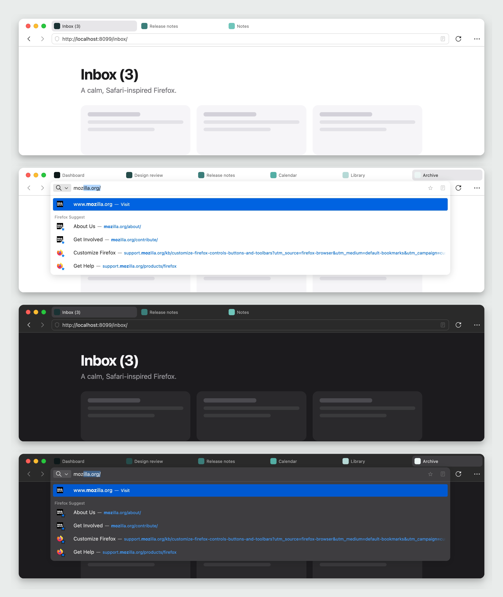

# MacFox Crisp

**So fresh and so clean –
the design-obsessed Mac user's dream.**

A minimal, Safari-inspired theme for Firefox on macOS, which still keeps tabs at the top of the window. A compact header, proper spacing and alignment and corner radius perfection. Design nerds rejoice!

> **Built on [macFox-theme](https://github.com/d0sse/macFox-theme) by d0sse**,
> thank you! d0sse's files are included unmodified; everything MacFox Crisp
> changes lives in its own folder on top.

> **Only tested on macOS** (Firefox 153, macOS 15). It uses macOS-specific
> behaviour and has not been tried on other systems.

<p align="center">
  
</p>

## Install

To start using MacFox Crisp, follow these steps:

### 1. Preferences

1. Go to the following url address `about:config`.
2. Ensure the following properties are set to `true` (create them as *Boolean*
   if they do not exist yet):

    ```text
    toolkit.legacyUserProfileCustomizations.stylesheets
    svg.context-properties.content.enabled
    browser.theme.native-theme
    ```

### 2. Install the theme

Install the theme using **either** the quick script (recommended) or the manual
steps below. This repository **is** the `chrome` folder Firefox reads: the two
loaders `userChrome.css` / `userContent.css` at the top, `macfox/` with the
upstream theme and `crisp/` with MacFox Crisp's changes.

#### Option A: Install script (recommended)

1. Clone the repo anywhere and run the installer:

    ```bash
    git clone https://github.com/hthomee/firefox-theme-macfox-crisp.git
    cd firefox-theme-macfox-crisp
    ./install.sh
    ```

    The script auto-detects your default Firefox profile and copies the
    theme's files into its `chrome` folder. An existing `chrome` folder is
    backed up first as `chrome.backup-<date>`. To target a specific profile,
    pass its path: `./install.sh /path/to/profile`.

2. Fully restart Firefox (`Cmd+Q`, then reopen) to apply changes.

#### Option B: Manual

1. Go to the following url address `about:support`.
2. Find "Profile Folder" section in the "Application Basics" list and copy the
   path (defined below as `$path`).
3. Open `terminal.app` and type:

    ```bash
    cd $path
    ```

4. If you already have a `chrome` folder, move it out of the way:

    ```bash
    mv chrome chrome.backup
    ```

5. Type in the following command:

    ```bash
    git clone https://github.com/hthomee/firefox-theme-macfox-crisp.git chrome
    ```

    No git? Download the repository as a ZIP, rename the unpacked folder to
    `chrome` and put it into the profile folder.

6. Fully restart Firefox (`Cmd+Q`, then reopen) to apply changes.

### Uninstall

Remove the `chrome` folder (or put your `chrome.backup` back) and restart.

## Credits and license

MacFox Crisp is built on top of
[macFox-theme](https://github.com/d0sse/macFox-theme) by **d0sse**, whose files
it ships unmodified in `macfox/`. The outline
shield shape comes from the
[WhiteSur Firefox theme](https://github.com/AdamXweb/WhiteSurFirefoxThemeMacOS)
by AdamXweb. Safari was the reference for the proportions; this project is not
affiliated with Apple or Mozilla.

MIT License, see [LICENSE](LICENSE).
